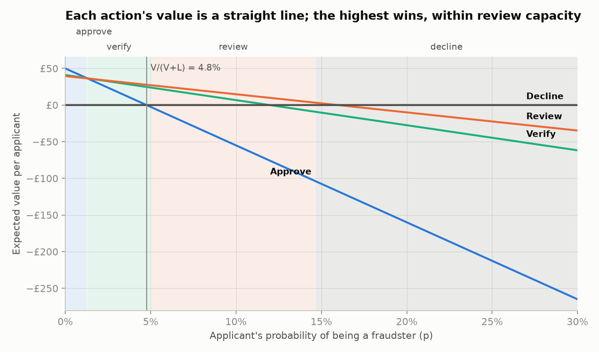
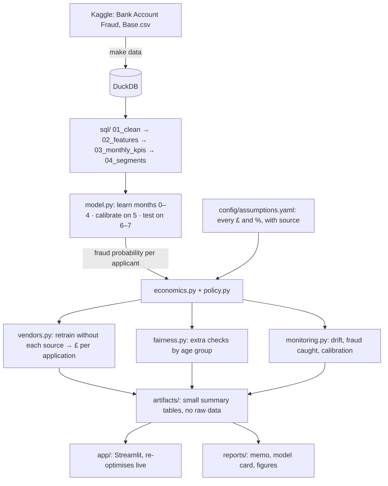

# Threshold

**How many good customers should a bank turn away to stop one fraudster?**

An onboarding decision engine. It turns a fraud score into **approve / verify / review / decline**,
prices every choice in pounds, and plans the review team around it.

[](https://github.com/aryaasoley/threshold/actions/workflows/ci.yml)

[**Live demo ▸**](https://aryaasoley-threshold.streamlit.app)

<!-- Record a 15-second GIF: drag "Loss per fraud" from £500 to £2,000 on the Policy page. -->
<!--  -->

## Results on two unseen months

<!-- results:start -->
_Filled in by `make report` from the real data. Every number comes with a 95% bootstrap range._
<!-- results:end -->

[One-page memo](reports/memo.md) · [How it works](docs/methodology.md) ·
[Assumptions and sources](docs/assumptions.md) · [Decision log](docs/decisions.md) ·
[Limitations](#limitations)

## Run it

```bash
uv sync      # Python 3.12 and pinned packages
make all     # download the data, train, decide, report (about 3 minutes)
make app     # open the policy simulator
```

`make data` needs a free Kaggle account: run `uv run kaggle auth login` once (see [DATA.md](DATA.md)).
No account? `make fake` runs the whole pipeline on generated data with the real column names.

## The idea in one chart



For an applicant with fraud probability *p*, each action's expected value is a straight line:

| Action | Expected value |
|---|---|
| Approve | (1 − p)·V − p·L |
| Verify | (1 − p)·(1 − a_g)·V − p·(1 − a_f)·L − s |
| Review | (1 − p)·(1 − f)·V − p·(1 − r)·L − c |
| Decline | 0 |

Pick the highest line at each *p*. Because they are straight lines, each action wins over one
band, and the band edges are where lines cross. Approve and decline cross at V / (V + L): if a
good customer is worth £50 and a fraud costs £1,000, a two-action policy declines everyone above
4.8%. The middle options keep many of those applicants. When the review band holds more cases
than the team can handle, the engine reviews the cases where a review adds the most, and the gain
on the best case left over is what one more analyst is worth. [Full method →](docs/methodology.md)

## What it does



| Question an operations team asks | Where Threshold answers it |
|---|---|
| Who do we approve, check, review or decline? | Policy page: four bands, priced in £ |
| How many genuine customers does our cut-off cost us? | Trade-off chart vs the best single cut-off |
| What is one more analyst worth? | Operations page: value of each extra analyst vs daily cost |
| What is the most we should pay a data vendor? | Vendors page: £ per application = break-even price per check |
| Who bears the extra checks? | Fairness: genuine applicants aged 50+ vs under 50 |
| Approvals dropped this week: why? | Monitoring: mix shift (PSI), model drift, or a policy change |

## How it was tested

- **On the future, not a shuffle.** Learn on months 0–4, calibrate and fix every cut-off on month 5,
  test on months 6–7. Nothing is tuned on the test months.
- **Honest probabilities.** Platt calibration on month 5 and a reliability chart; no oversampling.
- **Against simple alternatives.** Approve everyone, one cut-off at 5% FPR (the paper's way), and
  the best single cut-off, all fitted on the same month.
- **With ranges.** Bootstrap over both the calibration and test months; a sensitivity chart for
  every assumption.
- **Property tests.** Hypothesis checks the maths on thousands of random assumption sets: the chosen
  action is always the best, bands come in order, reviews never exceed capacity, more capacity
  never lowers profit, a higher fraud cost never increases approvals, and each extra analyst is
  worth no more than the last.
- **Data checks.** Rows per month, fraud rate in range, no −1 sentinel left, no test-month row used
  in training.
- **CI on every push.** Style → tests → the full pipeline on generated data, so no real data ever
  sits in the repo.

## Repository

```
config/assumptions.yaml   every £ and %, with source and date checked
sql/                      cleaning, features, monthly KPIs, policy segments (DuckDB)
src/threshold/            economics, policy, model, vendors, fairness, monitoring, pipeline
app/                      Streamlit: Policy, Operations, Vendors, Monitoring and fairness
tests/                    known-answer, random-input, data, leakage and pipeline tests
reports/                  memo, model card, results, figures
docs/                     methodology, decision log, experiment plan, assumptions
notebooks/                a guided tour that uses the code in src/
artifacts/                small result tables the app reads (no raw data)
```

## Limitations

- **Not a bank's data.** The dataset is partly synthetic and US-flavoured. The method transfers;
  the numbers don't. Nothing here describes any real bank.
- **The pounds are assumptions.** Defaults are sourced (see [assumptions](docs/assumptions.md)),
  the sensitivity chart shows which ones matter, and the app lets you enter your own.
- **No data on verification or review outcomes.** a_g, a_f, r and f are labelled assumptions;
  [the experiment plan](docs/experiment_plan.md) is how to measure them.
- **Labels arrive late in real life.** Monitoring leans on PSI, which needs none.
- **A tool for setting policy, not the live system that runs it.**

## Data and licence

Code: MIT ([LICENSE](LICENSE)). Data: Feedzai's Bank Account Fraud dataset (NeurIPS 2022), downloaded
from Kaggle and never committed. Credit, citation and licence terms are in [DATA.md](DATA.md).
