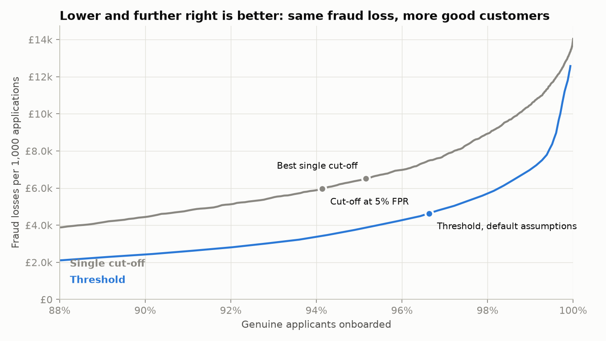
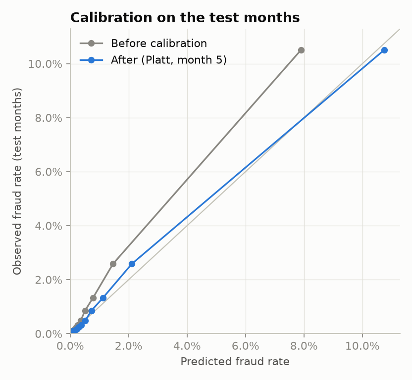
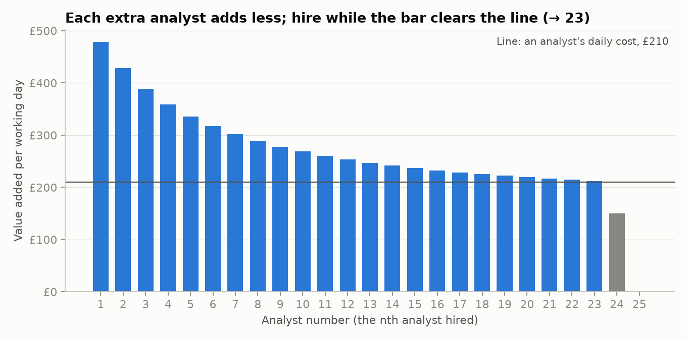
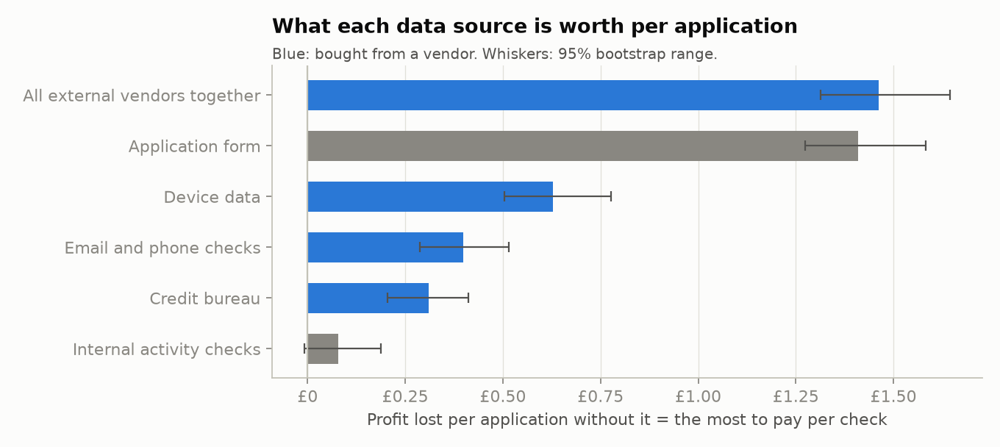
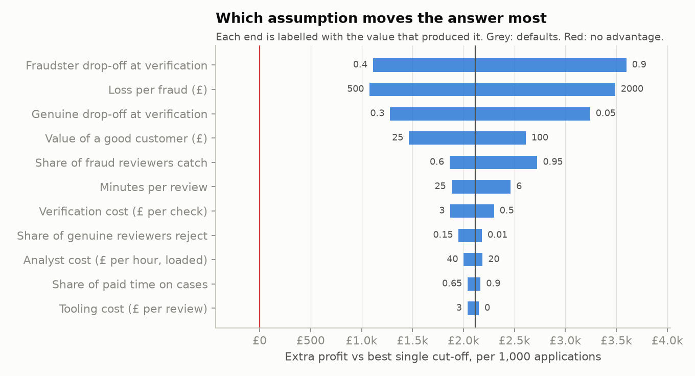

# Results

Generated by `make report` on 2026-10-09T01:48:45+00:00. Data: `feedzai-baf-base`,
1,000,000 applications; the test months (6, 7) hold
205,011 applications and 2,878 frauds. Cut-offs were
fixed on month 5 before the test months were scored. Ranges are 95% bootstrap intervals.

## Headline

- **3.7% (2.8% to 5.6%)** more genuine applicants onboarded at the same fraud loss as the best single cut-off (72.3% (66.3% to 77.2%) fewer turned away)
- **£2.1k (£1.9k to £2.4k)** extra profit per 1,000 applications vs the best single cut-off
- Device data worth **£0.63** per application (£0.50 to £0.78) → the most to pay that vendor per check
- Recommended review team: **23 analysts**. Analyst 24 would add £150 a day against a £210 daily cost, so hiring stops there

## Policies compared on the test months

| Policy | Profit per 1,000 | Genuine onboarded | Fraud stopped | Approve / verify / review / decline |
|---|---|---|---|---|
| Approve everyone | £35k | 100.0% | 0.0% | 100.0% / 0.0% / 0.0% / 0.0% |
| One cut-off at 5% FPR (paper) | £40k | 94.1% | 57.5% | 93.4% / 0.0% / 0.0% / 6.6% |
| Best single cut-off | £40k | 95.2% | 53.6% | 94.5% / 0.0% / 0.0% / 5.5% |
| Threshold (4 actions, capacity-aware) | £43k | 96.6% | 67.0% | 81.4% / 13.3% / 3.7% / 1.6% |

On the test months the cut-offs fixed on month 5 asked for 7,580 reviews
against capacity for 7,560; 7,560 were done.

## Model (test months, after calibration)

| Model | Fraud caught at 5% FPR | ROC AUC | Average precision | Brier |
|---|---|---|---|---|
| Logistic regression (baseline) | 50.9% | 0.881 | 0.163 | 0.0127 |
| Gradient boosting (sklearn-hgb, 275 trees) | 54.3% | 0.891 | 0.192 | 0.0125 |

## Review team

| Analysts | Capacity / day | Reviews / day | Value of this analyst / day | Worth hiring? |
|---|---|---|---|---|
| 0 | 0 | 0 | – | no |
| 1 | 30 | 30 | £479 | yes |
| 2 | 60 | 60 | £428 | yes |
| 3 | 90 | 90 | £389 | yes |
| 4 | 120 | 120 | £359 | yes |
| 5 | 150 | 150 | £335 | yes |
| 6 | 180 | 180 | £317 | yes |
| 7 | 210 | 210 | £302 | yes |
| 8 | 240 | 240 | £289 | yes |
| 9 | 270 | 270 | £278 | yes |
| 10 | 300 | 300 | £269 | yes |
| 11 | 330 | 330 | £261 | yes |
| 12 | 360 | 360 | £253 | yes |
| 13 | 390 | 390 | £247 | yes |
| 14 | 420 | 420 | £242 | yes |
| 15 | 450 | 450 | £237 | yes |
| 16 | 480 | 480 | £233 | yes |
| 17 | 510 | 510 | £229 | yes |
| 18 | 540 | 540 | £225 | yes |
| 19 | 570 | 570 | £222 | yes |
| 20 | 600 | 600 | £220 | yes |
| 21 | 630 | 630 | £217 | yes |
| 22 | 660 | 660 | £215 | yes |
| 23 | 690 | 690 | £212 | yes |
| 24 | 720 | 711 | £150 | no |
| 25 | 750 | 711 | £0 | no |
| 26 | 780 | 711 | £0 | no |
| 27 | 810 | 711 | £0 | no |

## Data sources

| Source | Supplier | Value per application | 95% range |
|---|---|---|---|
| All external vendors together | vendor | £1.46 | £1.31 to £1.64 |
| Application form | in-house | £1.41 | £1.27 to £1.58 |
| Device data | vendor | £0.63 | £0.50 to £0.78 |
| Email and phone checks | vendor | £0.40 | £0.29 to £0.51 |
| Credit bureau | vendor | £0.31 | £0.21 to £0.41 |
| Internal activity checks | in-house | £0.08 | −£0.01 to £0.19 |

## Fairness: genuine applicants given any extra check or declined

| Model | Policy | Under 50 | 50+ | Ratio |
|---|---|---|---|---|
| All data | One cut-off at 5% FPR (paper) | 4.3% | 13.7% | 3.16× ⚑ |
| All data | Best single cut-off | 3.5% | 11.6% | 3.30× ⚑ |
| All data | Threshold (4 actions, capacity-aware) | 14.7% | 33.3% | 2.26× ⚑ |
| All data except age | One cut-off at 5% FPR (paper) | 5.0% | 11.5% | 2.30× ⚑ |
| All data except age | Best single cut-off | 4.5% | 10.5% | 2.34× ⚑ |
| All data except age | Threshold (4 actions, capacity-aware) | 16.2% | 29.1% | 1.80× ⚑ |

⚑ = outside the 0.8×–1.25× band set in `config/assumptions.yaml`; escalate to Compliance.

## Monitoring (policy fixed on month 5, replayed month by month)

| Month | Approved | Fraud rate | Fraud stopped | Score PSI | Actual vs expected fraud | Reviews wanted / capacity |
|---|---|---|---|---|---|---|
| 5 (reference) | 83.4% | 1.18% | 64.9% | 0.000 (green) | -0% (green) | 3,780 / 3,780 |
| 6 (live replay) | 80.2% | 1.34% | 67.7% | 0.009 (green) | -8% (green) | 4,317 / 3,780 |
| 7 (live replay) | 82.7% | 1.47% | 66.0% | 0.011 (green) | +15% (green) | 3,263 / 3,780 |

Most-shifted features in the test months (PSI vs training months):

| Feature | Month | PSI |
|---|---|---|
| velocity_4w | 7 | 3.980 |
| velocity_4w | 6 | 3.724 |
| velocity_24h | 7 | 2.624 |
| velocity_24h | 6 | 1.579 |
| velocity_6h | 7 | 1.433 |

## Sensitivity

## Speed

Full pipeline: 180s on this machine. Stages: data and SQL layer 5.7s, model: baseline and gradient boosting 66.3s, model metrics and calibration 0.6s, model variants for vendor value and fairness 96.5s, probability histograms 1.3s, decisions and segment KPIs (SQL) 0.2s, policy comparison and trade-off curves 0.0s, value of an analyst 0.0s, value of each data source (paired bootstrap) 2.7s, fairness by age group 0.0s, monitoring and drift 3.8s, uncertainty: bootstrap (300 reps) and tornado 2.8s.
